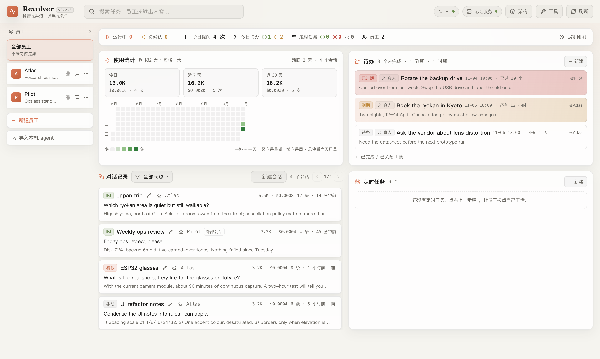
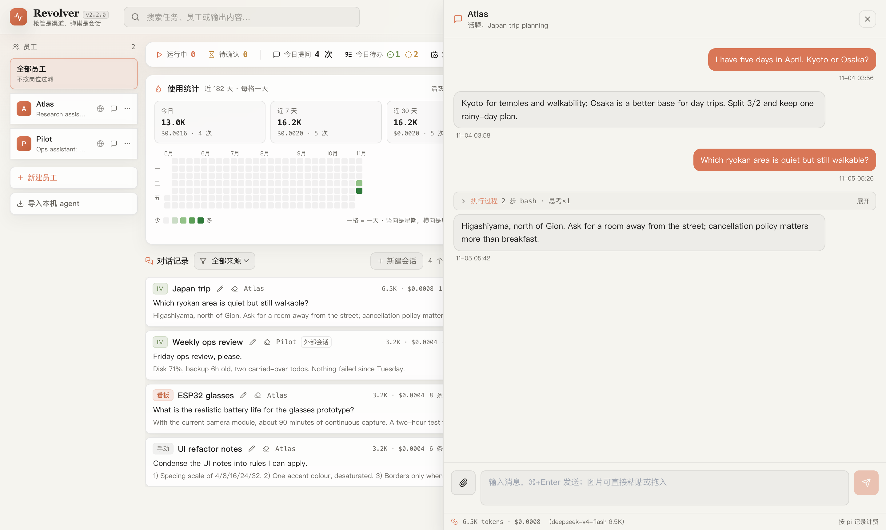

# Revolver

**A local, self-hosted AI teammate platform.** Many topics, one chat surface: say something and it lands in the right conversation — you don't go hunting for a session.

Built on [Pi](https://github.com/earendil-works/pi) (MIT). Feishu-native. Runs on your own machine.

[English](README.en.md) | [中文](README.md)

[](https://github.com/MoeWangG/revolver/actions/workflows/ci.yml)
[](LICENSE)



## Why "revolver"

The barrel is the channel, the cylinder is the session. Each message is a round: it should fire into the chamber that already holds that conversation, not into a fresh one.

Most agent tools make *you* manage context — pick a session, start a new chat, copy the old thread. This one tries the opposite: you just talk, and continuity is the platform's job.

## What makes it different

### 1. Topic-aware session routing

Every incoming message is scored against every existing conversation: title + summary card + sampled user messages + last assistant reply, embedded in chunks (max similarity, not average). A second, cheaper model arbitrates `continue / switch / new`, and low confidence always means "don't switch" — silently opening a new chamber is the most expensive mistake in this design.

If the embedding endpoint is down, routing degrades to lexical matching instead of failing. Every decision is logged to `data/routing.jsonl` so you can inspect *why* it switched.

→ [`src/core/topicRouter.ts`](src/core/topicRouter.ts:1) · [`src/core/semanticRoute.ts`](src/core/semanticRoute.ts:1) · [`src/core/topicArbiter.ts`](src/core/topicArbiter.ts:1)

### 2. Feishu-native, not "Feishu notifications"

Inbound messages arrive over Feishu's long connection (no public callback URL). Replies are rendered as interactive cards when they contain Markdown — with a plain-text fallback when the tenant can't render cards. `/topics` sends a collapsible card per conversation, with a button that moves the pointer; `/clear` resets only that Feishu conversation's context.

→ [`src/channels/feishu.ts`](src/channels/feishu.ts:1) · [`src/channels/topicCard.ts`](src/channels/topicCard.ts:1) · [`src/channels/mdCard.ts`](src/channels/mdCard.ts:1)

### 3. Memory and guardrails per teammate

Each teammate is a directory of five small files (`SOUL / identity / persona / bible / MEMORY`) plus `waker.yaml`. Independent LLM credentials and Feishu app per teammate. Policy is enforced at the **tool replacement layer**, not the event layer:

- command allow/deny lists (word-boundary matching, not naive substring)
- path allow/deny (credentials like `.ssh` / `.env` are blocked for both `read` and `bash`)
- optional Docker sandbox per teammate
- `selfEdit` lets a teammate rewrite its own prompt files — but **never** its policy; every write is backed up and logged

→ [`extensions/waker-guard.ts`](extensions/waker-guard.ts:1) · [`src/core/identity.ts`](src/core/identity.ts:1) · [`docs/技术说明.md`](docs/技术说明.md) (detailed design, Chinese)

## Architecture

```
Entry points (CLI / cron / Feishu / HTTP API / board)
        │
  Platform shell (this repo)
  ├─ registry     scan & validate teammate profiles
  ├─ identity     compile identity at build time (not per turn)
  ├─ guard        compile policy → data/policy/<id>.policy.json
  ├─ runner       spawn pi, queue per session, lock across processes
  ├─ scheduler    cron / one-shot / event
  ├─ board        task ledger + todos
  └─ gateway      HTTP data source + static board
        │ symlinked, never copied
  Pi extensions
  ├─ waker-identity   inject role prompt at before_agent_start
  └─ waker-guard      bash interception + optional Docker sandbox
        │
  Pi core (MIT)
```

The platform deliberately stays thin: ~15.6k lines of TypeScript plus ~6.9k lines of React. Pi keeps the agent loop; this repo owns identity, policy, routing, channels, scheduling and the console.

## Screenshots



Both screenshots come from an isolated demo workspace (`WAKER_AGENTS` / `WAKER_DATA` / `PI_HOME` under `/tmp`), not from a real account.

## Try it without touching your data

```bash
git clone https://github.com/MoeWangG/revolver.git
cd revolver

bash scripts/setup.sh     # dependencies, console build, Pi extension links, `waker` command
bash scripts/demo.sh      # seeds /tmp/revolver-demo and serves http://127.0.0.1:8799
```

The demo has two teammates, four conversations and a few todos. It never reads `agents/`, `data/` or `~/.pi`.

## Install

| Requirement | Why |
|---|---|
| **Node 22+** | runs the platform |
| **pnpm** | workspace installs |
| **[Pi](https://github.com/earendil-works/pi) CLI** (`npm i -g @earendil-works/pi-coding-agent`) | the agent kernel; without it the console still loads but cannot answer |
| Python 3.9+ *(optional)* | the bundled memory server |
| An embedding endpoint *(optional)* | semantic routing; falls back to lexical matching |
| A Feishu tenant *(optional)* | inbound messages and cards |

```bash
git clone https://github.com/MoeWangG/revolver.git
cd revolver
bash scripts/setup.sh         # idempotent; installs `waker` into ~/.local/bin
waker doctor                  # check node / pi / memory / docker
waker chat assistant          # interactive (creates agents/assistant on first use)
waker board --port 8787       # console at http://127.0.0.1:8787
```

## Use

```bash
waker say assistant "summarize today's work"    # one message, keeps context
waker sessions assistant                       # list conversations
waker chat assistant --new                     # start a new conversation
waker cron add assistant "0 9 * * *" "morning digest"   # scheduled task
waker tasks                                    # recent task ledger
```

**Feishu (optional).** Four steps:

1. Create a Feishu app and enable the long-connection event `im.message.receive_v1`.
2. Grant the bot message send/receive permissions and publish the app.
3. Put `appId` in `agents/<id>/waker.yaml` under `channels.feishu`; put `appSecret` in `agents/<id>/secrets.json` (git-ignored).
4. Restart `waker board`. Messages, Markdown cards and `/topics` are then live.

### Memory (optional)

The namespaced memory server lives in `vendor/multi-pi-memory`. It is **not started by default**:

```bash
bash vendor/multi-pi-memory/memory-server/install.sh   # interactive: picks an embedding backend
bash vendor/multi-pi-memory/scripts/start.sh           # http://127.0.0.1:8971
```

Without it, `MEMORY.md` and conversation history still work; only automatic cross-session recall is unavailable.

## Repo layout

| Path | What it is |
|---|---|
| `src/core/` | profile registry, identity compiler, runner, sessions, routing, todos |
| `src/channels/` | channel abstraction + Feishu implementation + card rendering |
| `src/scheduler/` | cron, one-shot, task ledger, board snapshot |
| `src/gateway/` | local HTTP API |
| `web/` | React console (Vite + Tailwind) |
| `extensions/` | Pi extensions injected by symlink |
| `examples/` | sanitized teammate template |
| `docs/` | product notes and design docs (Chinese) |
| `tests/` | 15 test files, 398 assertions, no test framework |

## Tests

```bash
npx tsc -p tsconfig.json --noEmit     # 0 errors
npm test                              # 15 files / 398 assertions
cd web && npm run build               # production console build

# or run the whole fresh-clone check (deps, types, tests, build, demo board)
bash scripts/smoke.sh
```

## Status and limitations

This is a **personal project, built for my own workflow** — not a supported product. Things you should know before trying it:

- Topic routing is currently wired into the **Feishu inbound path**. The web console picks a session explicitly.
- Semantic routing prefers a local embedding endpoint (`127.0.0.1:1234`, `text-embedding-bge-m3`) and falls back to lexical matching when it is unavailable.
- The memory server (a namespaced fork of `pi-memory`) is bundled under `vendor/`, but it is not started by default and needs Python 3.9+ plus an embedding backend.
- Sessions live in Pi's own store (`~/.pi/agent/sessions`); this repo never rewrites them.
- Tested on macOS. Linux should work; launchd-specific helpers won't.

## Documentation

- [Product notes (中文)](docs/产品说明书.md) — full feature and design documentation
- [Session switching (中文)](docs/会话切换.md) — how routing, arbitration and the pointer layer fit together
- [Changelog](CHANGELOG.md) — every version, with *why* and how it was verified

## License

[MIT](LICENSE)
