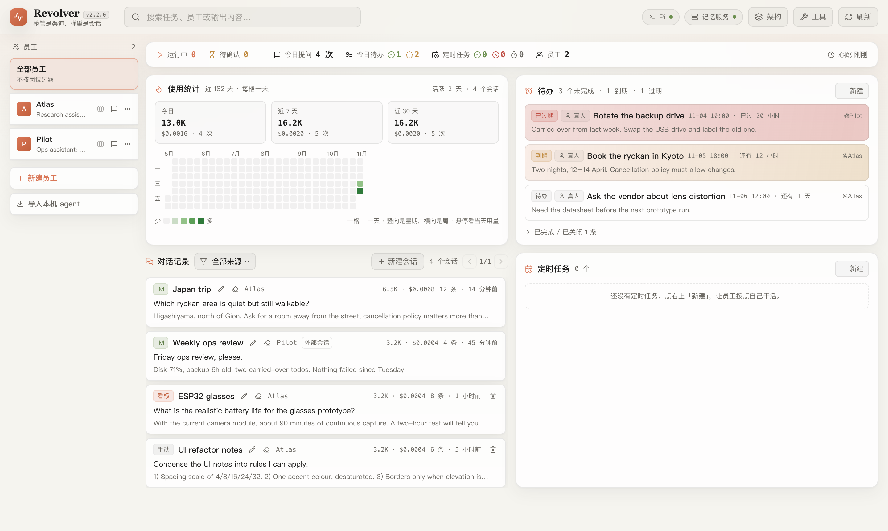
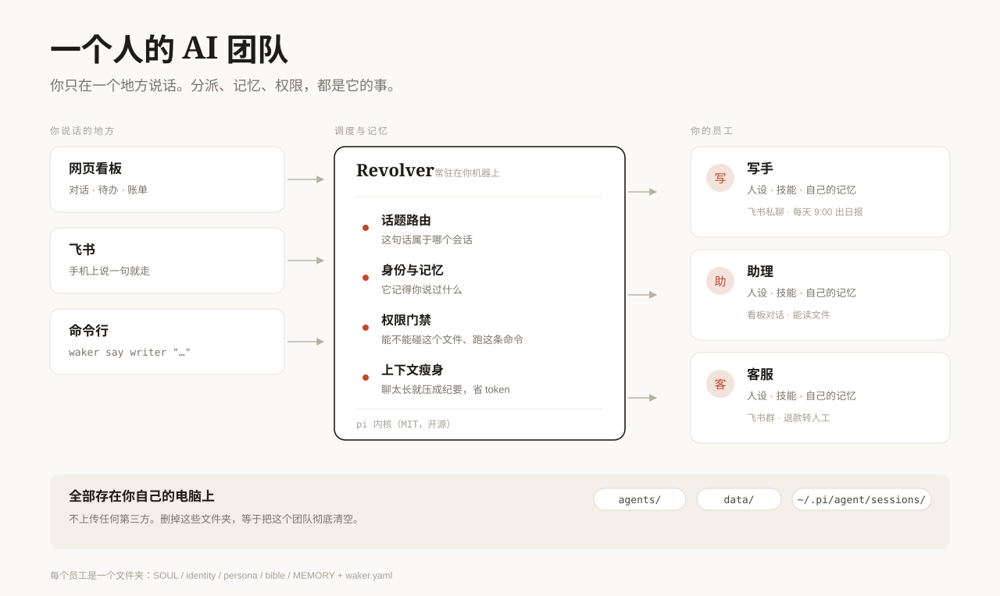
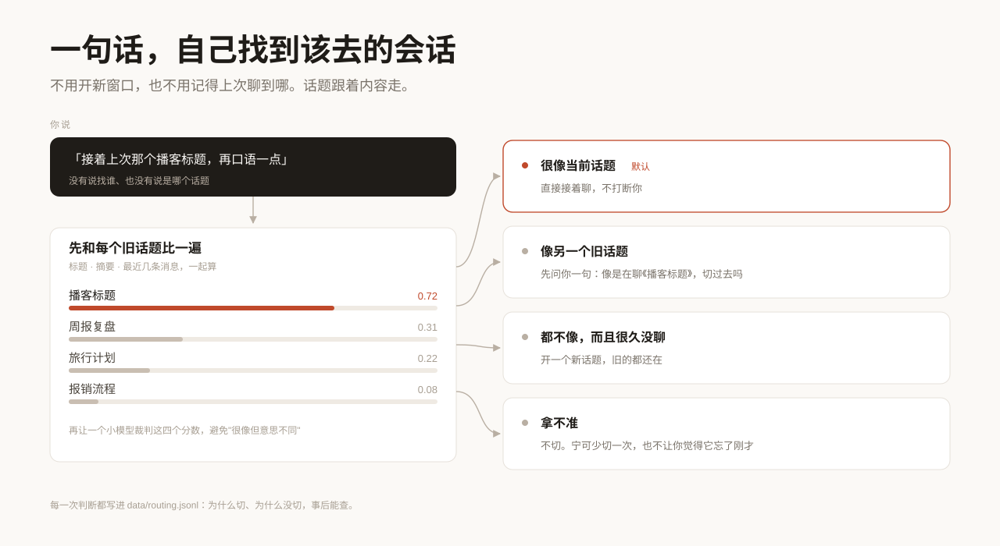

# Revolver · 一个人的 AI 团队，跑在你自己电脑上

[English](README.en.md) | 中文



一句话：**你只管说话，它自己把这句话交给该听的那个 AI。**

你可能有 3 个、5 个甚至 10 个 AI —— 写手、助理、客服、选题、写代码的。现在的做法是开一堆窗口，自己记得"这件事该找谁"、"上次聊到哪了"。这个项目把这件事反过来：**你只有一个说话的地方**（网页或飞书），剩下的分派、记忆、上下文都由它负责。

---

## 它解决三个问题

### ① 数据资产在你自己手里

**现在的做法**：人设、聊天记录、长期记忆，全在别人的服务器上。你没法确认它拿去做了什么，也没法带着走。模型一停服，你的"员工"就没了。

**这里的做法**：Agent 和记忆都是**你电脑上的文件**——员工档案在 `agents/`，记忆库和任务流水在 `data/`，会话在 `~/.pi/agent/sessions/`。删掉文件夹等于彻底清空，备份就是拷目录。底层 Pi 和这层外壳全是 MIT 开源，数据到底发去了哪，你自己能审计。

### ② 不用自己判断该进哪个会话

**现在的做法**：一个 AI 开一堆窗口，你得回忆"上次是不是在这个窗口聊的"、"这句该新开还是接着聊"。回忆错了，它就像失忆一样重新问一遍。

**这里的做法**：一句话进来，它先和每个旧话题比一遍，再决定——像当前话题就**直接接着聊**；像另一个旧话题就**问你一句"切过去吗"**；都不像才开新话题；拿不准一律**不切**。你不需要说"这是新话题"，也不需要翻聊天记录。

### ③ 一个人管多个 agent，在手机上就能派活

**现在的做法**：多个 agent 各占一个 App、一个窗口、一个订阅；想在手机上用，还得复制粘贴来回倒。

**这里的做法**：每个员工是一个独立岗位——**自己的人设、自己的技能、自己的记忆、自己的飞书应用**，各司其职、互不串台。一个人在看板里招人、派活、看账单；在手机上通过飞书直接给它发消息，它会自己找到对的那个话题接着干，还能按你的作息跑定时任务（比如每天 9 点出日报）。

> 人设和技能都能改，改完**下一句就生效**；你也可以授权它在备份留痕的前提下改自己，但权限本身永远不在可改范围内。

---

## 一张图看懂



员工不是"一个模型"，而是**一个文件夹**，五份小文件决定它是谁、怎么说话、什么不能做、记得什么：

```
agents/writer/            ← 目录名是员工 id（英文），显示名写在 waker.yaml 里
├── SOUL.md        它是谁、怎么判断、什么语气
├── identity.md    它服务谁、负责什么
├── persona.md     工作习惯、产出格式
├── bible.md       红线：哪些事必须先问你
├── MEMORY.md      长期记忆
└── waker.yaml     用哪个模型、能碰哪些目录、能不能跑命令、接哪个飞书
```

---

## 自动切换是怎么判的



这是它和"一个 AI 开一堆会话"最本质的区别：**话题跟着内容走，不跟着窗口走。**

- 你在飞书私聊里随口一句"那个预算表帮我改下"，它自己回到做预算表的那条线，不用你翻聊天记录。
- 判断靠两样东西：**这句话和每个话题的相似度** + **一个小模型做裁判**。裁判没把握时一律不切——宁可少切一次，也不让你觉得它"忘了刚才"。
- 每一次判定都写进 `data/routing.jsonl`：为什么切、为什么没切，事后能查。
- 想自己控制也行：看板里列着这个员工的全部话题卡片，点一下就切，跟自动判定不冲突。

---

## 为什么不用现成的

| 你在用的 | 问题 |
|---|---|
| 各种闭源 AI 平台 | 你的对话、文件、客户资料都在别人服务器上。不开源 = 你没法确认它拿你的数据干了什么 |
| 把上万字上下文一股脑塞给模型的产品（OpenClaw 这类） | 每次提问都重发整段历史。上下文越大越贵，而且大部分内容跟这次的问题无关 |
| 同时开 8 个桌面 agent | 你自己当调度员：切窗口、复制粘贴、记不清哪个聊过什么 |

这个项目的三个取舍：**本地优先**（档案、记忆、会话都是本机文件）、**只发该发的那部分**（按话题分流 + 超长自动压成纪要）、**一个入口多个员工**（不用记谁是谁）。

---

## 安装（一条命令）

需要先有：**macOS 或 Linux**、**Node 22 以上**（没有的话装一个 Node 就行）。

```bash
git clone https://github.com/MoeWangG/revolver.git
cd revolver
bash scripts/setup.sh
```

`setup.sh` 会把该装的都装完，不用你再选任何东西：命令行工具、网页界面、模型内核、员工模板、跨会话记忆。

装完它会告诉你下一步做什么。通常是：

```bash
waker chat assistant      # 和你的第一个员工说话（第一次会让你登录/填模型 key）
waker board --port 8787   # 或者打开网页看板 http://127.0.0.1:8787
```

> 只想先看看长什么样、不碰任何配置：`bash scripts/demo.sh`，它会用一份假的演示数据起在 8799 端口。

### 关于模型

对话要有模型。两种都行：

- **用云端的**：DeepSeek、通义、OpenAI 之类，一个 key 就够，按量付费。
- **用本机的**：装了 LM Studio 或 Ollama 就能完全离线、零成本，数据一个字节都不出机器。

第一次 `waker chat` 会引导你配好，之后不用再管。

---

## 开始用

员工 id 用英文（它会变成目录名），岗位和显示名用中文：

```bash
waker agent new writer --role "写公众号和小红书稿子" --cwd ~/Documents/writing
waker agent new support --role "回答产品问题，遇到退款就转人工"

waker chat writer          # 和它单独聊（保留上下文，下次接着聊）
waker say writer "把上次那篇改成 800 字"   # 一句话，适合写脚本

waker board --port 8787    # 看板：今天谁干了什么、花了多少、有哪些待办
```

看板上能做的事：新建/编辑员工、看每个员工花了多少钱和多少 token、看定时任务、看待办、改权限、接飞书。

### 接飞书（手机上派活）

在员工的 `waker.yaml` 里填上飞书应用的 `appId`，`secrets.json` 里填 `appSecret`，重启看板即可。用飞书的长连接收消息，**不需要公网服务器、不需要域名**。

一个员工一个飞书应用，所以你可以让写手和客服在不同私聊里各干各的；也可以把多个员工拉进同一个群，看它们各自接活。

---

## 你花的钱去哪了

- 每次对话只发**跟当前话题相关**的内容，不是整个历史。
- 聊得太长（默认超过 3 万 token）会自动压成一段纪要，旧原文归档留底。之后的每一轮只带纪要。
- 看板能看到每个员工的今日 / 7 天 / 30 天花费，按模型单价实时算。
- 每个员工可以配不同的模型：写作用的贵一点，客服的便宜一点。

---

## 你的数据在哪

| 东西 | 位置 | 会不会上传 |
|---|---|---|
| 员工档案、人设 | `agents/<员工>/` | 不会，只在你本地 |
| 聊天记录 | `~/.pi/agent/sessions/` | 不会 |
| 记忆、任务流水、话题判定日志 | `data/` | 不会 |
| 模型调用 | 直接连你配的那家（或本机模型） | 只发本次要处理的内容 |

`agents/` 和 `data/` 默认不进 git（`.gitignore` 已挡），不会因为 `git push` 泄露。

---

## 常见问题

**要花多少钱？**
按 token 算。日常问答和写作，通常一天几分到几毛钱；用本机模型则是 0。看板里有实时账单。

**断网能用吗？**
接本机模型（LM Studio / Ollama）可以完全离线。

**能管几个员工？**
没有硬限制，实际用 3~10 个最舒服。每个员工可以有自己的模型、飞书应用、权限。

**它会乱删我文件吗？**
默认每个员工都有一层门禁：能跑哪些命令、能碰哪些目录、碰到删改/发布要不要先问你。这些都在 `waker.yaml` 里写着，改之前会提醒你影响。

**能改它吗？**
MIT 协议，整个仓库你都能读能改。没有隐藏的闭源组件。

---

## 想深入原理

- 会话分流怎么判、阈值怎么定：[`docs/会话切换.md`](docs/会话切换.md)
- 完整技术说明（安全模型、员工档案、IM 渠道、目录结构）：[`docs/技术说明.md`](docs/技术说明.md)
- 产品说明书（每个功能为什么这么做）：[`docs/产品说明书.md`](docs/产品说明书.md)
- 版本记录：[`CHANGELOG.md`](CHANGELOG.md)

## License

MIT
